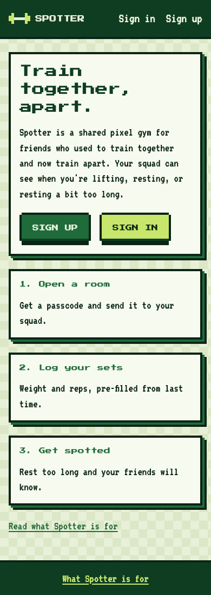
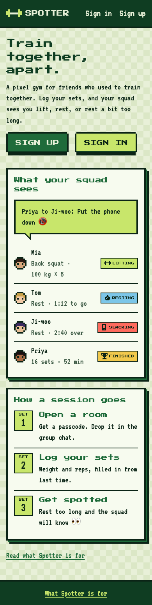
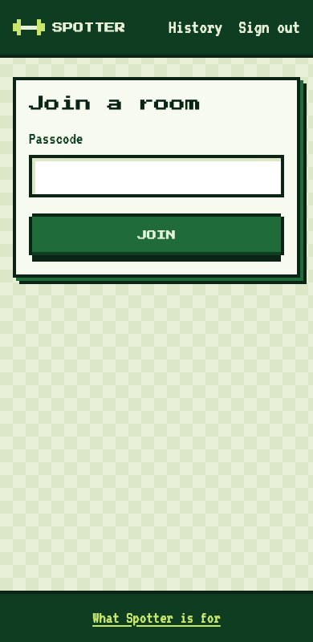
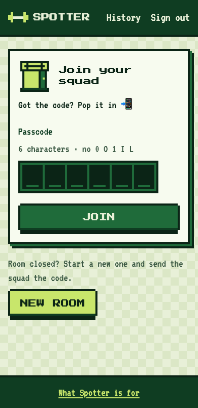

# Process overview

Version 3, written for Crit 10 (week 11).

## From the brief to a spec (Crit 8)

The final project asks for something completely different from the crits and the earlier assignments. All it requires is a multi-user website, which is easy. But that also means there is much more room to show what I learned and thought about this semester.

The easy way to pick a topic would be to ask Claude for suggestions. The problem is how attention works: Claude's ideas are always reinventing the wheel. You can find a thousand similar websites online. I wanted to build something nobody had tried before, and something that actually solves a problem.

So I wrote down [a rough idea](docs/product/idea.md) from my own story: a virtual gym that lets people work out together even when they live apart. I believe an app like this would actually push someone like me to go back to the gym and start training again.

Then I fed this rough idea to the agent. I asked for a production-grade spec, and it gave me [a launch plan stretching over twenty weeks](docs/product/spec-mvp.md). So I had to ask it again to cut the plan down to [four weeks](docs/product/spec-4-weeks.md), which is what this project actually needs ([`88b3e0d`](https://github.com/comp4020-agentic-coding-studio/comp4020-final-dongyangli6816/commit/88b3e0d)). From then on I used that doc to keep the agent pointed at the goal ([`fce8475`](https://github.com/comp4020-agentic-coding-studio/comp4020-final-dongyangli6816/commit/fce8475), [`36eea8b`](https://github.com/comp4020-agentic-coding-studio/comp4020-final-dongyangli6816/commit/36eea8b)).

## Choose the tech stack (Crit 8)

When selecting tech stacks, I asked Claude to give me several options based on the project. Eventually I chose Astro in server mode on Node, with SQLite on the `/data` volume through Drizzle.
Full details in [ADR 0001](docs/adr/0001-stack.md). In short, the machine has256 MB, one volume and no database server, so the stack has to be one process that owns its own file.

## First build (Crit 8)

With the spec doc ready, I started building. The first thing I did was migrate my `CLAUDE.md` rules from [the last crit](https://github.com/comp4020-agentic-coding-studio/comp4020-crit7-dongyangli6816/blob/960131a/CLAUDE.md), but this time I only brought over the git rule instead of all of them ([`c8718ed`](https://github.com/comp4020-agentic-coding-studio/comp4020-final-dongyangli6816/commit/c8718ed)). This project is not like any of the previous crits or assignments. It is a full stack app that will take more than a month and around $1000 of tokens to build, so rules that worked on a small prototype may not work here. I kept the git rule and started the rest fresh.

The building stage for Crit 8 went smoothly. The spec doc was good enough that a couple of simple prompts got me a small demo page ([`c8718ed...01ce3ef`](https://github.com/comp4020-agentic-coding-studio/comp4020-final-dongyangli6816/compare/c8718ed...01ce3ef)). The design is not as good as I pictured though ([the pages as shipped](docs/evidence/2026-10-07-designer-redesign/before/), tag [`crit-8`](https://github.com/comp4020-agentic-coding-studio/comp4020-final-dongyangli6816/tree/crit-8)), so next week, on top of the crit tasks, I want to work on the design of the app.

## My first agent - designer (Crit 9)
This follows up on my concern from last week. When I built the first version of the app, the only design instruction I gave Claude was pixel style and a deep green theme ([`8f3c111`](https://github.com/comp4020-agentic-coding-studio/comp4020-final-dongyangli6816/commit/8f3c111)). The result was so AI. Every page was just words and buttons. It read like a ten thousand word essay written by AI, the kind that makes you lose interest in a millisecond.

What fixed it was a separate agent that only does design. At my last job as a software engineer I always worked with a UI/UX designer, and they designed our pages off a big design system: which colors to use, which colors to avoid, who our users are, and so on. I wanted the same thing in my workflow, so I asked Claude to build my first custom agent, [the designer](.claude/agents/designer.md), along with [the design system](docs/design/system.md) it designs from ([`f010c1b`](https://github.com/comp4020-agentic-coding-studio/comp4020-final-dongyangli6816/commit/f010c1b)).

To put the designer into the workflow, I added a `CLAUDE.md` rule: the main agent has to decide whether a feature touches a page. If it does, it has to wake the designer first and design the page before implementing it ([`2286a37`](https://github.com/comp4020-agentic-coding-studio/comp4020-final-dongyangli6816/commit/2286a37)). The main
agent is not allowed to edit any front end code without a design in hand. I also added the same rule as a hook ([`4acfc6b`](https://github.com/comp4020-agentic-coding-studio/comp4020-final-dongyangli6816/commit/4acfc6b); [why a hook](docs/evidence/2026-10-08-design-gate-hook/README.md)).

Then I ran the existing pages back through this workflow, and it worked incredibly well ([`4fc046e`](https://github.com/comp4020-agentic-coding-studio/comp4020-final-dongyangli6816/commit/4fc046e), [`3a67afc`](https://github.com/comp4020-agentic-coding-studio/comp4020-final-dongyangli6816/commit/3a67afc), [`55fad94`](https://github.com/comp4020-agentic-coding-studio/comp4020-final-dongyangli6816/commit/55fad94), [`132f839`](https://github.com/comp4020-agentic-coding-studio/comp4020-final-dongyangli6816/commit/132f839); [how it was run](docs/evidence/2026-10-07-designer-redesign/README.md)). The contrast is below.

| Home, before | Home, after | Join, before | Join, after |
| --- | --- | --- | --- |
|  |  |  |  |

It does come at a cost. On the same page, the designer workflow uses about five times as many tokens and takes about ten times as long as doing it without a design step. Thanks to the Opus 5.5 update brought the price down though, so I can live with the trade off.

## Other Claude.md rules I added (Crit 9)
**Repository map** As the project got bigger, every new conversation started the same way: I asked Claude to do something, and it spent longer and longer walking the project to find the file it had to edit. The docs were part of the problem. Every workflow I added left more of them lying around the repo, with no order to any of it. So I made a repository map, so the agent can look up which file to edit and where a new file belongs ([`fce8475`](https://github.com/comp4020-agentic-coding-studio/comp4020-final-dongyangli6816/commit/fce8475)).

**Branches and pull requests** This is for repo protection and it is a common practice in industry. AI is non-deterministic, and on a project this size it can run out of context and just commit everything it has, finished or not, straight to my main branch. I added the rule to keep that off main and keep the commit history readable ([`4fbc0ed`](https://github.com/comp4020-agentic-coding-studio/comp4020-final-dongyangli6816/commit/4fbc0ed)). Before it, every commit went straight to `main` ([`88b3e0d`](https://github.com/comp4020-agentic-coding-studio/comp4020-final-dongyangli6816/commit/88b3e0d) to [`207ea31`](https://github.com/comp4020-agentic-coding-studio/comp4020-final-dongyangli6816/commit/207ea31)); after it, each feature arrived as its own pull request ([`9337b9d...c8e3dd3`](https://github.com/comp4020-agentic-coding-studio/comp4020-final-dongyangli6816/compare/9337b9d...c8e3dd3)).

## Reading the app from its logs (Crit 10)
Crit 10 asks two things of the app: the server decides who can see and change what, and I can narrate two people using it from the server's log alone. My first question to the agent was whether that meant building an admin site. It doesn't. The log is just what the server prints, and `flyctl logs` shows it. Before this week, Spotter printed nothing.

I didn't let the agent start on code. I had it plan first, and the plan began with a read-only review of every request the server answers, listing what each one checks. The review found the ownership checks sound and four gaps. I decided the scope: three gaps fixed ([`50655fe`](https://github.com/comp4020-agentic-coding-studio/comp4020-final-dongyangli6816/commit/50655fe), [`2801c15`](https://github.com/comp4020-agentic-coding-studio/comp4020-final-dongyangli6816/commit/2801c15), [`d8cdc97`](https://github.com/comp4020-agentic-coding-studio/comp4020-final-dongyangli6816/commit/d8cdc97)), the rest written down as trade-offs in [ADR 0006](docs/adr/0006-who-can-do-what.md), and the interactions and gym worker moved to next week ([`cb8fa8f`](https://github.com/comp4020-agentic-coding-studio/comp4020-final-dongyangli6816/commit/cb8fa8f)). The logs themselves are one JSON line per action, with a line for every refusal too ([`252a254`](https://github.com/comp4020-agentic-coding-studio/comp4020-final-dongyangli6816/commit/252a254)).

Two things kept the agent honest. Each new test was run against the old code to show that it fails there; the three stream tests did. And the rate limit added an error state to sign-in, so the design gate sent it to the designer first, even though it was a security fix ([`bd76143`](https://github.com/comp4020-agentic-coding-studio/comp4020-final-dongyangli6816/commit/bd76143)). A local rehearsal with two browsers showed that the log reads as a story ([evidence](docs/evidence/2026-10-17-two-browser-logs/README.md)), and it caught one noisy line ([`69c937e`](https://github.com/comp4020-agentic-coding-studio/comp4020-final-dongyangli6816/commit/69c937e)).
