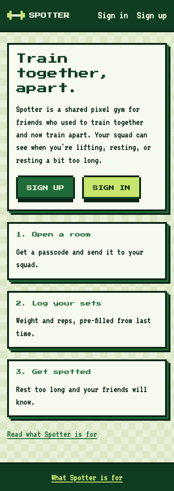
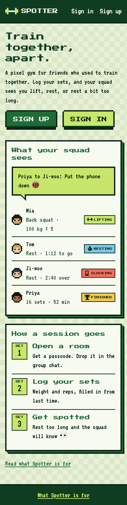
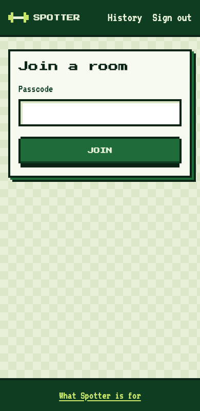
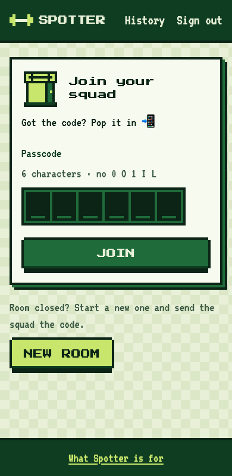

# Process overview
Final Version

## Workflow Overview
![How Spotter gets built, in two levels, drawn with the app's own pixel characters, each holding a tool for its job. Top: three features built at once on 5 November, one agent team per git worktree, all branched from main at commit 1503a8e. On the left, I appear as Dony, handing out the features. Three lanes, each a full team of pm, designer, qa round one, main agent and qa round two: gym worker delivery on feat/delivery-worker, PR 27; the logbook refactor on feat/logbook-refactor, PR 30; and room interaction on feat/room-interaction, PR 31. A NOW tag marks one example moment, not a record: the delivery team's main agent is building, the logbook team's designer is designing, and the room team's pm is writing criteria. Every lane merges into main, which deploys to Fly.io. Bottom: the room interaction lane, zoomed in. My request: "The interaction part in the gym is a bit monotonous. I want to improve it." Then six steps run left to right: 1, the pm agent writes acceptance criteria and open questions; 2, I settle the questions and write the server contract; 3, the designer makes a mockup and spec; 4, qa round one writes the tests before any code, without reading src; 5, the main agent builds until the tests pass and may not edit them; 6, qa round two runs browser tests three times and screenshots the pages against the mockups, then I merge. Dashed red arrows send work back: a code bug from qa round two to the main agent, a test that looks wrong from the main agent to qa round one, and a gap in the criteria from qa round two to me.](docs/evidence/2026-11-09-workflow-diagram/workflow.png)

The idea behind my workflow is to keep myself out of the loop as much as possible. I only step in where a person has to decide, such as what to build, the open questions the pm agent can't settle, and whether to merge. Everything else is done by agents and checked by other agents. Why I think this is good practice beyond this project is argued in my [research note](research-note.md).

For the stack, I chose Astro on Node with SQLite on the volume. The full reasoning and the options I turned down are in [ADR 0001](docs/adr/0001-stack.md) ([`cdcb62f`](https://github.com/comp4020-agentic-coding-studio/comp4020-final-dongyangli6816/commit/cdcb62f)).

## My first agent - designer
When I built the first version of the app, the only design instruction I gave Claude was pixel style and a deep green theme ([`8f3c111`](https://github.com/comp4020-agentic-coding-studio/comp4020-final-dongyangli6816/commit/8f3c111)). The result was so AI. Every page was just words and buttons, the kind of page that makes you lose interest in a millisecond.

What fixed it was a separate agent that only does design. At my last job as a software engineer I always worked with a UI/UX designer, and they designed our pages off a big design system: which colors to avoid, who our users are, and so on. I wanted the same thing in my workflow, so I asked Claude to build my first custom agent, [the designer](.claude/agents/designer.md), along with [the design system](docs/design/system.md) it designs from ([`f010c1b`](https://github.com/comp4020-agentic-coding-studio/comp4020-final-dongyangli6816/commit/f010c1b)).

To put the designer into the workflow, I added a `CLAUDE.md` rule: the main agent has to decide whether a feature touches a page. If it does, it is not allowed to touch any front end code until the designer has designed the page ([`2286a37`](https://github.com/comp4020-agentic-coding-studio/comp4020-final-dongyangli6816/commit/2286a37)). I also added the same rule as a hook ([`4acfc6b`](https://github.com/comp4020-agentic-coding-studio/comp4020-final-dongyangli6816/commit/4acfc6b); [why a hook](docs/evidence/2026-10-08-design-gate-hook/README.md)).

Then I ran the existing pages back through this workflow, and it worked incredibly well ([`4fc046e...132f839`](https://github.com/comp4020-agentic-coding-studio/comp4020-final-dongyangli6816/compare/4fc046e...132f839); [how it was run](docs/evidence/2026-10-07-designer-redesign/README.md)). The contrast is below.

| Home, before | Home, after | Join, before | Join, after |
| --- | --- | --- | --- |
|  |  |  |  |

It does come at a cost. On the same page, the designer workflow uses about five times as many tokens and takes about ten times as long as doing it without a design step. TThanks to the Opus 5.5 update brought the price down though, so I can live with the trade off.

After the first version of the designer, I kept iterating on it to bring the token and time cost down.

The first problem was pixel art. It drew every sprite out of hundreds of `<rect>`s, and since it has to read a whole mockup before editing it, every edit got more expensive. I told it to draw each sprite once, one `<path>` per colour, and reuse it, which took the room mockup from 779 KB to 209 KB ([`6bc8a71`](https://github.com/comp4020-agentic-coding-studio/comp4020-final-dongyangli6816/commit/6bc8a71); [evidence](docs/evidence/2026-10-15-32px-sprites/README.md)). Then I stopped it from drawing existing art at all, so mockups now pull the real sprites from a shared sheet built out of `src/sprites/` ([`cb87239`](https://github.com/comp4020-agentic-coding-studio/comp4020-final-dongyangli6816/commit/cb87239), [`8fc2d55`](https://github.com/comp4020-agentic-coding-studio/comp4020-final-dongyangli6816/commit/8fc2d55)).

Screenshots were the second problem. It used to shoot each page as one 28,000 px image, then write a throwaway script to crop it on every run, so I changed `shot.mjs` to take one screenshot per state and told the designer to look at a shot again only after it changed something that shows up in it ([`1cb9d72`](https://github.com/comp4020-agentic-coding-studio/comp4020-final-dongyangli6816/commit/1cb9d72)). Last, I briefed it to make fewer tool calls, which took the second half of the gym redesign from 84 calls and $15.50 down to 49 calls and $6.50 ([evidence](docs/evidence/2026-10-15-32px-sprites/README.md)).

## My second and third agents - pm, qa
For Crit 8 and Crit 9 I did not pay much attention to the tests. I let the main agent write all the CI checks and left them alone. Then, while I was submitting last week's work, I noticed one check had failed twice in five PRs. I went looking for what went wrong, and it turned out to be a badly designed test. The agent wanted to check that changing the shirt color works, so it wrote a check that always picks the grey shirt and then looks at whether the color changed. But the shirt color is picked at random when the page loads, so one time in eight the shirt is already grey, the color does not change, and the test fails ([the test](spec/browser/lobby.spec.ts), fixed in [`ef92e02`](https://github.com/comp4020-agentic-coding-studio/comp4020-final-dongyangli6816/commit/ef92e02)).

I asked Claude to fix the test, then started thinking about how to avoid bugs like it. After looking into it, I think the mix of roles is the reason. The main agent wrote all the tests right after it finished writing the code. When you ask someone to check their own work, they look for the passes. With Claude it is worse. A lot of the time it will just loosen the test until it passes. So I decided to separate testing from coding (the "Deciding and testing features" rule in [CLAUDE.md](CLAUDE.md)).

The idea behind this agent is that the QA agent's only source of truth should be the spec doc, not the coder, so the tests it writes stay faithful to what the app is supposed to do. But I found [my spec doc](docs/product/spec-4-weeks.md) is too vague for a QA agent. It usually describes a feature in one line and says nothing about edge cases, which the main agent used to just decide for itself while implementing.

So I added [a PM agent](.claude/agents/pm.md). Its job is to take a one line feature and turn it into a doc listing the expected behaviors, based on things like who our users are and the vibe of the app ([its criteria files](docs/product/criteria/), for example [the animations](docs/product/criteria/animations.md)). With that doc in hand, I could finally build [the QA agent](.claude/agents/qa.md) ([`17f564f`](https://github.com/comp4020-agentic-coding-studio/comp4020-final-dongyangli6816/commit/17f564f)). 

After adopting this workflow, my tokens and time flowed away like water. On the first feature through it, the exercise animations, qa's two rounds alone took about two hours of agent time and 240k tokens. It did catch some bugs the main agent had missed. But the main agent also found four bugs in the tests themselves ([evidence](docs/evidence/2026-10-20-qa-agent/README.md); criteria [`cc9fb84`](https://github.com/comp4020-agentic-coding-studio/comp4020-final-dongyangli6816/commit/cc9fb84), feature and tests [`85f65d8`](https://github.com/comp4020-agentic-coding-studio/comp4020-final-dongyangli6816/commit/85f65d8)), so I will keep working on the workflow.

## Work in Parallel
With this workflow, a medium size feature takes two to three hours and a large one usually takes more than five, and there is nothing I can do while I wait. I tried running two Claude agents on two different features at the same time. But they were in the same repo on the same git, so I ran into a serious concurrency problem. The two agents kept editing the same file, reading each other's edits, reverting them, and looping forever.

So I needed a mechanism that lets two or more agents work on different features at once. I borrowed the idea of a lock from operating systems. When an agent starts editing files in the repo, it acquires a worktree lock, and no other Claude session can edit there. Any new session that sees the lock has to create its own worktree and make its edits in there ([`0328233`](https://github.com/comp4020-agentic-coding-studio/comp4020-final-dongyangli6816/commit/0328233); [evidence](docs/evidence/2026-11-03-worktree-lock/README.md)). The branching rules matter just as much here: each session works in its own worktree on its own branch, so the only thing left to sort out is the conflicts when the pull request goes up ([`28e7ed7`](https://github.com/comp4020-agentic-coding-studio/comp4020-final-dongyangli6816/commit/28e7ed7)).

I tested this with three features in three Claude sessions and it worked really well ([#27](https://github.com/comp4020-agentic-coding-studio/comp4020-final-dongyangli6816/pull/27), [#30](https://github.com/comp4020-agentic-coding-studio/comp4020-final-dongyangli6816/pull/30), [#31](https://github.com/comp4020-agentic-coding-studio/comp4020-final-dongyangli6816/pull/31), all branched from [`1503a8e`](https://github.com/comp4020-agentic-coding-studio/comp4020-final-dongyangli6816/commit/1503a8e)). I finished all three in one day ([evidence](docs/evidence/2026-11-09-workflow-diagram/README.md)). Doing them one after another would have taken me more than two days.

## Other Claude.md rules I added
**Repository map** As the project got bigger, every new conversation started the same way. I asked Claude to do something, and it spent longer and longer walking the project to find the file it had to edit. The docs were part of the problem. Every workflow I added left more of them lying around the repo, with no order to any of it. So I made a repository map, so the agent can look up which file to edit and where a new file belongs ([`fce8475`](https://github.com/comp4020-agentic-coding-studio/comp4020-final-dongyangli6816/commit/fce8475)).

**Branches and pull requests** This one is for repo protection. AI is non-deterministic, and on a project this size it can run out of context and just commit everything it has, finished or not, straight to my main branch. I added the rule to keep that off main and keep the commit history readable ([`4fbc0ed`](https://github.com/comp4020-agentic-coding-studio/comp4020-final-dongyangli6816/commit/4fbc0ed)). Before it, every commit went straight to `main` ([`88b3e0d`](https://github.com/comp4020-agentic-coding-studio/comp4020-final-dongyangli6816/commit/88b3e0d) to [`207ea31`](https://github.com/comp4020-agentic-coding-studio/comp4020-final-dongyangli6816/commit/207ea31)); after it, each feature arrived as its own pull request ([`9337b9d...c8e3dd3`](https://github.com/comp4020-agentic-coding-studio/comp4020-final-dongyangli6816/compare/9337b9d...c8e3dd3)).