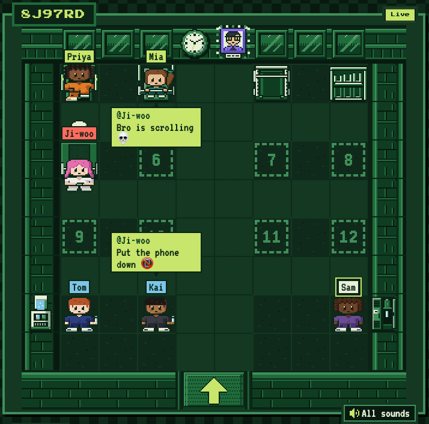

# Spotter

Spotter is a pixel-art gym where everyone logs their own sets, and everyone else
can see who is lifting, who is resting, and who has been resting way too long.

## Who it's for

A squad of friends who used to train together and now live apart. In most squads
there is one disciplined person, and the rest of us only went because that
person was going. When I moved to Australia I stopped going to the gym
completely.

## What good means here

1. **The room is small, and you pick who is in it.** Clay Shirky's
   [Situated Software](http://shirky.com/essays/situated-software/) argues for
   software built "for a specific social group, rather than for a generic set of
   users", and [Tong et al. (2021)](https://doi.org/10.1145/3474711) found that
   *Animal Crossing* islands you need a code to enter felt friendlier than
   public worlds. So a room needs a passcode and holds twelve people at most.
   Right now you send the code to your friends, but you could just as easily
   drop it in a Reddit thread.
2. **It only works if people can see you.**
   [Feltz, Kerr and Irwin (2011)](https://doi.org/10.1123/jsep.33.4.506) found
   that the weaker partner works harder when a stronger partner can see their
   effort, even over a screen. That is exactly my roommate and me. So the first
   thing you see is who is lifting, who is resting and who is slacking, and your
   friends can poke you about it. It should feel like the group chat, not like
   being told off.
3. **Logging has to be fast.**
   [Li, Dey and Forlizzi (2010)](https://doi.org/10.1145/1753326.1753409)
   found that the most common reasons people struggle to keep a personal log
   are not having the tool at hand, forgetting, and not having the time, and
   that the burden gets worse the more often you have to record. A gym log is
   recorded every set, one-handed, in a short rest. If logging is slower than
   whatever app the disciplined friend already uses, that friend leaves, and
   then nobody else has a reason to stay. So a set is two taps, with the
   weight and reps filled in from last time. If this ever gets in the way of something fun, the
   fast version wins.
4. **The boring parts need a Gen Z twist.** A gym log is mostly a rest timer, a
   number and a list of sets. I want each of those to be something you would
   screenshot for the group chat. Rest too long and the screen tells you
   `Your squad can see you 👀`. A friend can slap you back to work, or tell you
   `Bro is scrolling 💀`. Training earns accessories for your avatar. The jokes are about
   what you did, not about your body or your weight, and none of them get in the
   way of logging a set. What I left out is the usual fix, points and
   leaderboards. [Mekler et al. (2017)](https://doi.org/10.1016/j.chb.2015.08.048)
   found they "did not significantly affect competence or intrinsic
   motivation", and only made people do more. An accessory is something you
   wear, not a score.

## What I chose not to build

I want Spotter to end up as a place where people who train meet each other, like
the shy person who would rather wave at you on Spotter than say hello in
person. My first spec had all of that, with public rooms, matchmaking and
moderation. I cut it after reading Shirky's line that "the N-squared problem is
only a problem if N is large", and Robin Sloan's
[home-cooked app](https://www.robinsloan.com/notes/home-cooked-app/) convinced
me the small room has to work on its own first.
[Eagle et al. (2024)](https://dl.acm.org/doi/full/10.1145/3689648) found that
being watched by a stranger can make people anxious. So the room is built to
make a stranger easy to approach. You can high-five someone instead of having a
conversation, and the nudges are banter rather than judgement.

## Enforced and judged

- **The room is small.** A thirteenth person cannot get into a full room
  ([invites](https://github.com/comp4020-agentic-coding-studio/comp4020-final-dongyangli6816/blob/main/spec/invites.test.ts)),
  ten wrong passcodes lock you out
  ([access](https://github.com/comp4020-agentic-coding-studio/comp4020-final-dongyangli6816/blob/main/spec/access.test.ts)),
  and nobody outside a room can watch it live
  ([realtime](https://github.com/comp4020-agentic-coding-studio/comp4020-final-dongyangli6816/blob/main/spec/realtime.test.ts)).
- **People can see you.** A set logged in one browser shows up on every other
  screen within a second, and the server decides when you turn Slacking, not
  your phone
  ([realtime](https://github.com/comp4020-agentic-coding-studio/comp4020-final-dongyangli6816/blob/main/spec/realtime.test.ts)).
  Cheers, pokes and slaps reach everyone in the room within a second too
  ([interactions](https://github.com/comp4020-agentic-coding-studio/comp4020-final-dongyangli6816/blob/main/spec/interactions.test.ts)).
- **Logging is fast.** Weight and reps come from your last set
  ([core loop](https://github.com/comp4020-agentic-coding-studio/comp4020-final-dongyangli6816/blob/main/spec/core-loop.test.ts)),
  and if you log a set while the gym worker is still carrying your equipment in,
  it saves straight away
  ([delivery](https://github.com/comp4020-agentic-coding-studio/comp4020-final-dongyangli6816/blob/main/spec/delivery.test.ts)).
- **The jokes have limits.** The ten preset messages are fixed word for word,
  and nobody can slap you mid-set
  ([interactions](https://github.com/comp4020-agentic-coding-studio/comp4020-final-dongyangli6816/blob/main/spec/interactions.test.ts)).
  A PB goes out to the room without any numbers in it
  ([room feel](https://github.com/comp4020-agentic-coding-studio/comp4020-final-dongyangli6816/blob/main/spec/room-feel.test.ts)),
  and you unlock accessories from training, cheers and high-fives
  ([accessories](https://github.com/comp4020-agentic-coding-studio/comp4020-final-dongyangli6816/blob/main/spec/accessories.test.ts)).